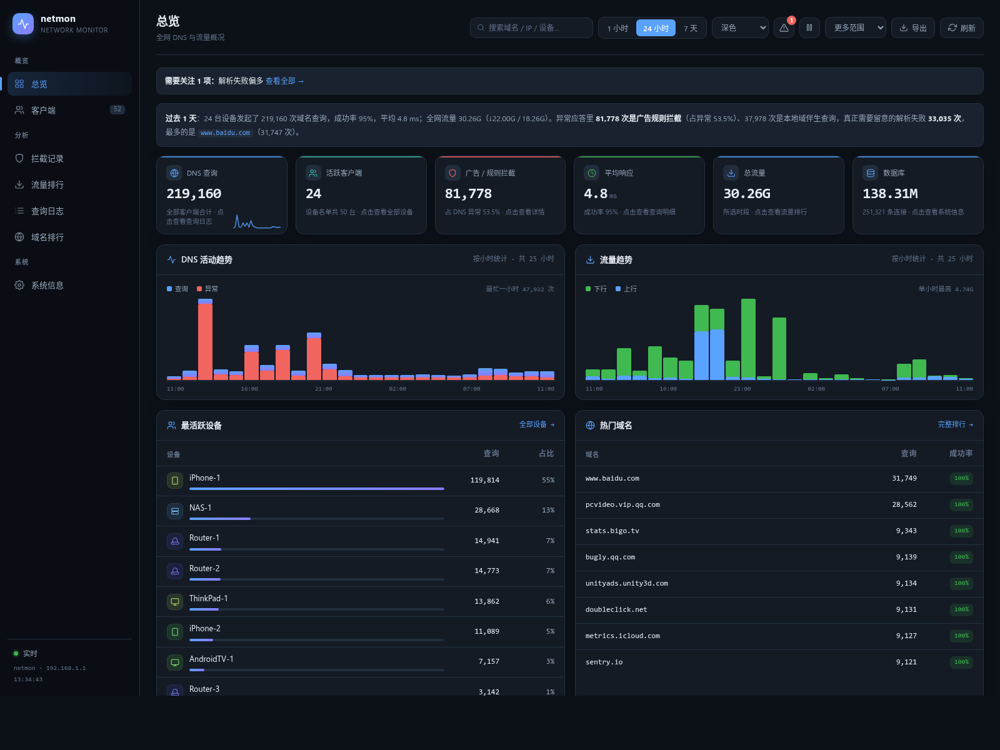
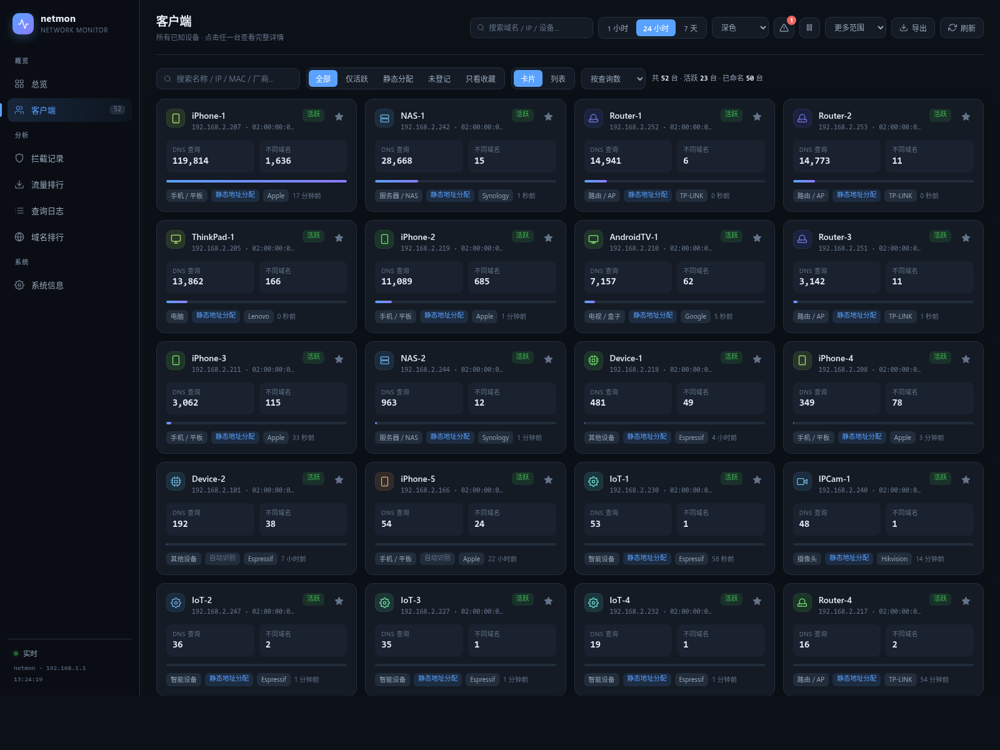
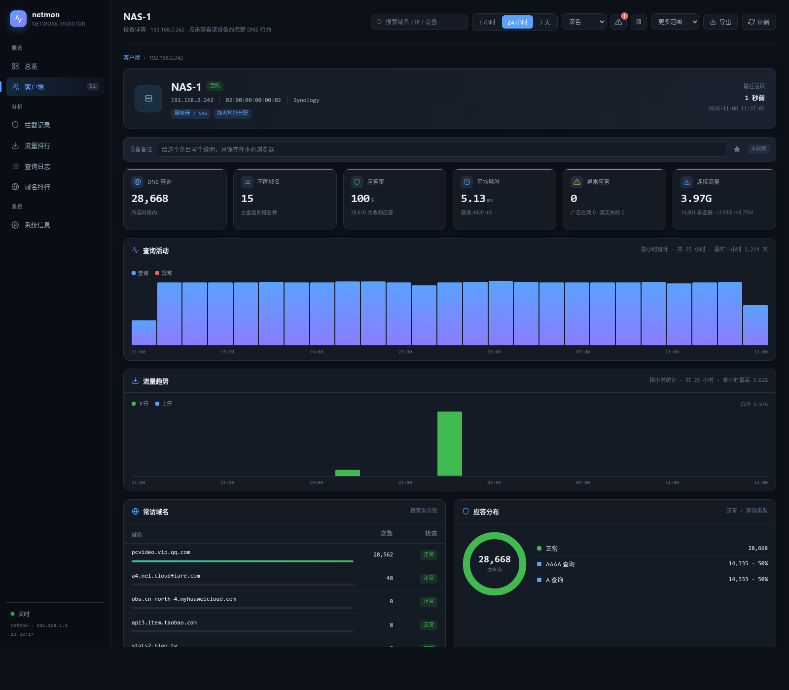
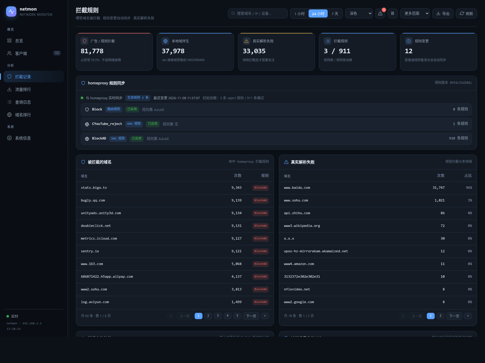
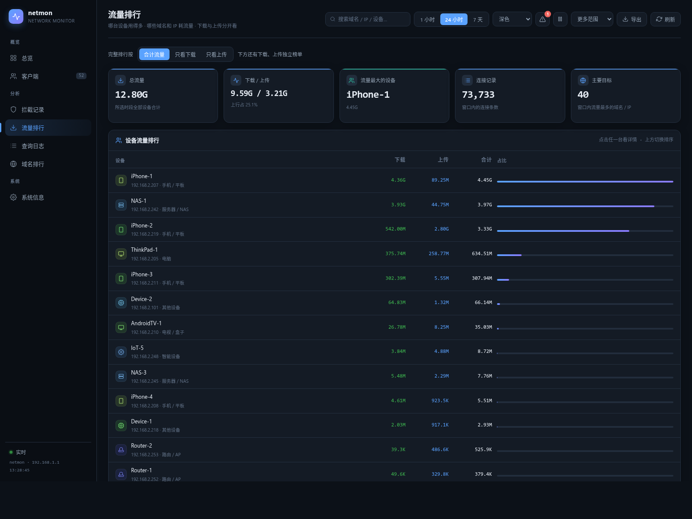
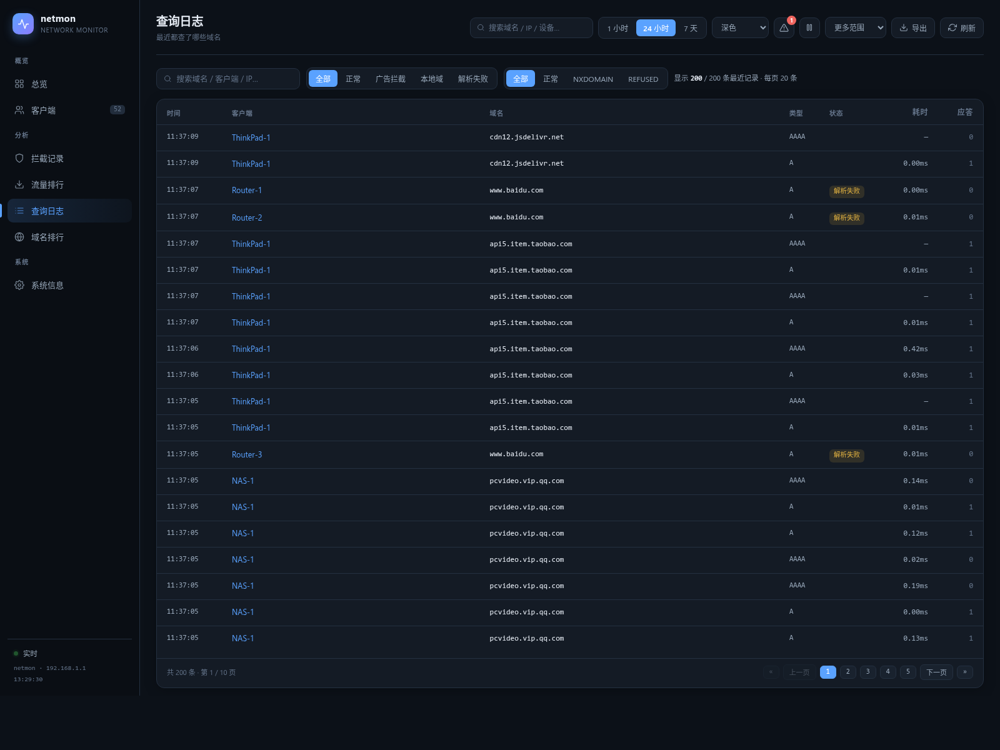
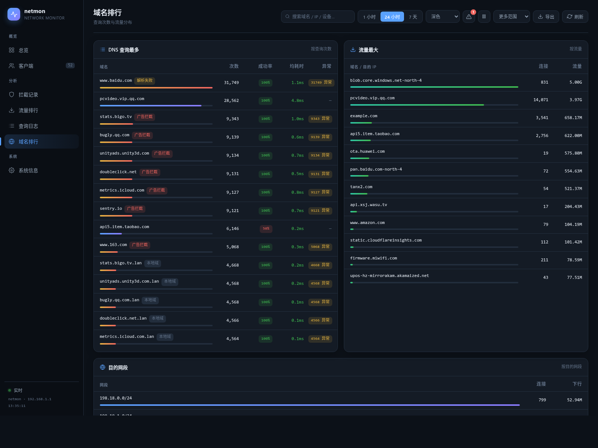
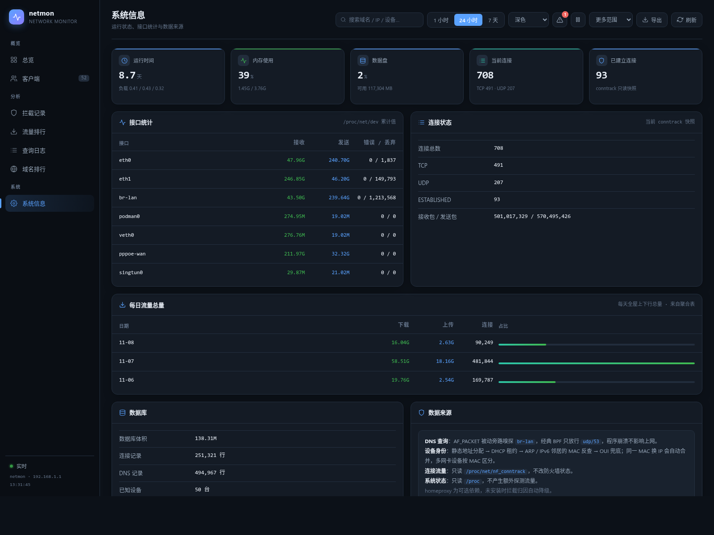
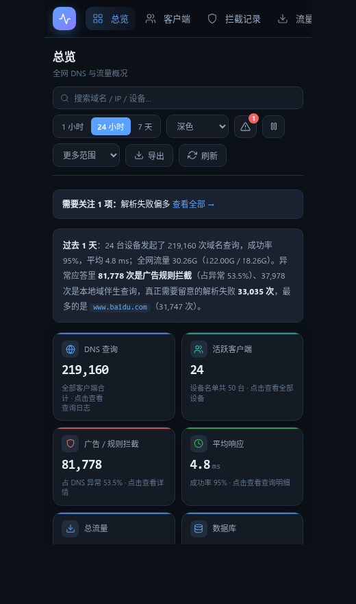

# netmon

**OpenWrt / ImmortalWrt 上的被动网络监控 —— 不碰转发路径，只看，不改。**

<p>
<a href="https://tccmu.com/netmon/demo/"></a>
<a href="https://github.com/xiaofami/netmon/actions/workflows/build.yml"></a>
<a href="https://github.com/xiaofami/netmon/releases"></a>
</p>

> **https://tccmu.com/netmon/demo/** ← 完整交互式面板，不用装路由、不用连设备，
> 点开就能翻榜单、下钻设备、切皮肤。数据全部脱敏。

一台路由器就是全家的网络出口，但绝大多数路由系统只会告诉你「现在跑多少兆」。
netmon 想回答的是更难的那类问题：

- 过去一天，哪个设备、哪个域名真正吃掉了带宽？
- 解析失败的域名里，哪些是被广告规则拦了，哪些是真的解析不出来？
- 内网这台「未命名设备」到底是谁？（换了 IP 还能认出来）
- 家里几十台 IoT 设备，谁在偷偷往外报数据？



> 截图取自上面那个演示页，两者数据同源：设备名、MAC、内网地址、域名
> 都是生成的示例值，不对应任何真实环境。

---

## 它和别的监控有什么不同

| | AdGuard Home | ntopng | pfSense / OPNsense | **netmon** |
|---|---|---|---|---|
| 工作方式 | 接管 DNS | 抓包分析（libpcap） | 统计接口字节 | **旁路只读** conntrack + udp/53 嗅探 |
| 影响转发路径 | 是（DNS 必经） | 部分（需镜像端口） | 否 | **否** |
| 需要改 dnsmasq / 防火墙 | 是 | 视部署 | 否 | **否** |
| 设备级 DNS 行为 | 有 | 弱 | 无 | **有，含设备画像** |
| 拦截归因（解释「为什么解析失败」） | 只能看自己拦的 | 无 | 无 | **有，读 homeproxy 规则实时对齐** |
| 资源占用 | 中等 | 高 | 内置 | 采集进程单核 **0.08%** |

一句话：**它不参与任何决策，所以装错了也不会断网。** 这是设计约束，不是巧合 ——
所有数据都来自 `/proc/net/nf_conntrack` 与一块 AF_PACKET 套接字（BPF 只放行 udp/53），
不发探测包、不注入、不改任何别人的配置（只写自己的 `netmon` 配置段）。

## 功能

### 总览
六张 KPI（查询量、活跃客户端、拦截数、平均响应、总流量、库体积）+ DNS 活动趋势 +
流量趋势 + 最活跃设备 + 热门域名 + 站内告警 + 一句话摘要。顶部自动判断
「现在最值得关注的一件事」，点进去就是对应视图。

### 客户端与设备画像


- **按 MAC 归并**：设备换了 IP 不会变成两台；静态分配生效后自动以新地址为准。
- **多网卡识别**：同一台机器的有线和无线是两张网卡，会标「多网卡」而不是算成重复。
- **静态未生效提示**：配了静态租约但设备还在用旧地址时，卡片上直接标出旧地址。
- **收藏 / 备注**：写在浏览器 localStorage，不落库、不同步。

设备详情页有 DNS 活动、流量趋势、应答分布三块图，以及常访域名、查询日志、
流量目的地等可翻页榜单：



### 拦截记录


把「DNS 查询失败」拆成三类：**广告/规则拦截**、**本地域名（`.lan` 的 NXDOMAIN）**、
**真实解析失败**。前者来自 homeproxy 规则表实时对齐，后者才是需要排查的。

这里的归因是**读规则表再匹配**，不是拦流量 —— netmon 从不丢弃任何包。

### 流量排行


下载 / 上传分开统计，四张榜（设备上下行、域名 IP 上下行），可切合计排序；
另有目的网段分布。数据源是 conntrack 的字节计数差，不是抓包统计。

### 查询日志 / 域名排行



两秒级查询日志（可翻页、可按归因筛选）、域名排行（按查询量 / 按流量）、
一键导出 CSV。

### 系统信息


对标 pfSense 的 dashboard widget：接口收发、conntrack 状态、每日流量总量、
数据库体积。全部只读 `/proc`。

### 其它

- **6 套皮肤**：深色 / 浅色 / Midnight / Nord / Solar / 高对比，纯 CSS 变量。
- **移动端适配**：390px 下自动切顶部导航与单列卡片。
- **零前端依赖**：单文件原生 JS，无框架、无 CDN、无构建步骤。
- **LuCI 集成**：出现在「状态 → 监控面板」，可配端口、监听地址、保留天数、采样间隔。



---

## 安装

### 方式一：apk 包（推荐）

从 [Releases](https://github.com/xiaofami/netmon/releases) 下载对应架构的包。
每个架构一个 `netmon-*.apk`，`luci-app-netmon-*.apk` 所有架构通用：

| 架构 | 适用设备 |
|---|---|
| `x86_64` | x86 软路由、虚拟机（PVE / ESXi / Hyper-V） |
| `aarch64_generic` | 通用 ARMv8（armsr/armv8：树莓派、多数 ARM 开发板） |
| `aarch64_cortex-a53` | MT7981 / MT7986 系列 WiFi6 路由器（mediatek/filogic） |

```sh
apk add --allow-untrusted ./netmon-*-<架构>.apk ./luci-app-netmon-*.apk
```

装完即启动，面板在 **`http://<路由器 LAN IP>:8090/`**，
LuCI 里在「状态 → 监控面板」。包是 `apk-tools 3`（ImmortalWrt 25.x / apk）格式，
OpenWrt 24.10 及更早用 opkg，需要自己编译（见下）。

依赖只有 `ip-full`、`uhttpd`、`kmod-nf-conntrack`，全部来自官方仓库。
SQLite 静态链接进二进制，**不需要** `libsqlite3-0`；`homeproxy` 是可选增强，
没装时拦截归因自动降级，其余功能不受影响。

> 上面三个架构由 GitHub Actions 在云端编出来（见下面的「云端构建」）。
> 你的设备不在表里？用源码编，过程同样不需要路由器在线。

### 方式二：自己编 apk（任意架构）

不需要路由器在线，也不需要 OpenWrt 的完整构建树 —— 只要对应 target 的 SDK。
拿个别的架构举例（比如 MT7621）：

```sh
git clone https://github.com/xiaofami/netmon && cd netmon

# 1. 下 SDK（去 downloads.immortalwrt.org 找对应 target）
curl -fLO https://downloads.immortalwrt.org/releases/25.12.2/targets/ramips/mt7621/\
immortalwrt-sdk-25.12.2-ramips-mt7621_gcc-14.3.0_musl.Linux-x86_64.tar.zst
mkdir sdk && tar --use-compress-program=unzstd -xf *.tar.zst -C sdk --strip-components=1

# 2. 交叉编译出两个二进制（sqlite 会一起编）
SDK_DIR=$PWD/sdk sh build/cross-build.sh build/out

# 3. 打包。架构名查该 target 的 profiles.json 里的 arch_packages
python3 build/build-apk.py --bin-dir build/out --arch mipsel_24kc --sdk sdk
# → dist/netmon-1.0.0-r3-mipsel_24kc.apk
```

### 方式三：本机跑测试（不产出 apk）

```sh
sh src/get-sqlite.sh        # 下载 SQLite amalgamation 并编成本机静态库
cd src && make && make test # 89 项 C 断言
cd .. && node build/render-test.js   # 126 项前端断言
```

### 云端构建

`.github/workflows/build.yml` 干三件事：

1. **测试**：C 单元测试 + 前端渲染测试 + 静态检查 + 演示页脱敏自检，四条都过才继续
2. **编译**：x86_64 / aarch64_generic / aarch64_cortex-a53 三个架构并行，
   各自下载对应 SDK（带缓存），交叉编译后打包，产物挂在本轮运行上
3. **发布**：打 `v*` tag 时自动创建 Release 并附上全部 apk 与 `SHA256SUMS`

想加架构：在 `build.yml` 的 matrix 里加一行，`sdk` 填 SDK 文件名、
`arch` 填该 target `profiles.json` 里的 `arch_packages`，仅此而已。

交叉编译用的是 `build/cross-build.sh`，它只做一件事 —— 用 SDK 的编译器编出两个
二进制，再交给同一个 `build-apk.py` 打包。所以**云端打出来的包与本地从路由器
取二进制的包，结构完全一致**（安装脚本、配置保留、apk-new 清理这些坑都是
一次次踩出来的，不能在 CI 里另写一份）。

---

## 配置

所有配置都在 `/etc/config/netmon`，也可以在 LuCI 设置页里改：

```uci
config netmon 'main'
    option enabled     '1'
    option http_port   '8090'
    option listen_addr 'lan'                        # lan / 具体 IP / 127.0.0.1
    option db_path     '/opt/netmon/data/netmon.db'
    option retain      '30'                         # 明细保留天数
    option interval    '5'                          # conntrack 采样间隔（秒）
    option loglevel    '0'
```

改完执行 `/usr/bin/netmon-apply` 生效（LuCI 保存时会自动调用）。这个脚本是幂等的：
校验端口 → 建目录 → 重写 `uhttpd.netmon` 实例 → reload → 重启采集。

**面板没有鉴权**，`listen_addr` 不要设成 `0.0.0.0`，除非你在防火墙上另做了限制。

### 命令行

```sh
netmon-report status                       # 库概况
netmon-report devices --since 24h          # 设备清单
netmon-report client --ip 192.168.1.100    # 单台设备详情
netmon-report detail --type qname --key example.com
netmon-report dashboard --since 1d -j      # 前端用的完整 JSON
```

全部支持 `--since 1h|24h|7d` 与 `-j`（JSON）。

---

## 资源占用

x86_64 软路由，24 小时窗口约 43 万条 DNS、20 万条连接：

| 指标 | 数值 |
|---|---|
| 采集进程 CPU | 单核 0.08% |
| 采集进程 RSS | 83.6 MB（其中 64 MB 是 SQLite 页缓存） |
| 数据库增速 | 约 1.4 GB / 月（30 天保留期，含明细） |
| CGI 缓存命中 | 28 ms |
| 冷查询（首次聚合） | 约 4 s（每 10 秒窗口最多一次） |

小 flash 机型把 `retain` 降到 3–7 天、页缓存调到 8 MB，RSS 可压到 25–30 MB。
优化过程（覆盖索引、10 秒窗口缓存、以及踩过的坑）见
[docs/PERFORMANCE.md](docs/PERFORMANCE.md)。

---

## 架构

```
                    ┌──────────────────────────────┐
 /proc/net/         │  netmon （常驻，procd 托管）  │
 nf_conntrack ─────▶│  ├─ ctsample   5s 采样        │
                    │  ├─ ctparse    解析文本行      │
 AF_PACKET ────────▶│  ├─ dnssniff   udp/53 旁路    │──▶ SQLite
 (BPF: udp/53)      │  └─ dnsmap     域名反查        │    /opt/netmon/data
                    └──────────────────────────────┘
                                   │
                    ┌──────────────▼───────────────┐
                    │  netmon-report （按需执行）   │
                    │  聚合 → JSON / 文本           │
                    └──────────────┬───────────────┘
                                   │
        uhttpd ──▶ /cgi-bin/data ──┘        （10 秒窗口文件缓存）
                └▶ /www/netmon/index.html   （单文件前端，6 套皮肤）
```

**为什么用 C**：路由器上内存与 flash 都紧张，常驻进程要能连续跑几个月不涨内存。
纯 C + 静态链接 SQLite，二进制 1.1 MB，无运行时依赖。

**为什么前端不用框架**：面板只在局域网用，加载越快越好。单文件 145 KB，
首次打开不需要等待任何外部资源。

## 目录

```
src/            采集与报表（C）
www/            前端单文件 + CGI 脚本
package/        OpenWrt 包定义（netmon / luci-app-netmon）
build/          开发工具：离线渲染自检、脱敏演示页生成、apk 打包
docs/           设计、部署、性能、打包、UX 等完整记录
                （docs/demo/ 是在线演示页，由 GitHub Pages 发布）
screenshots/    README 用图（由脱敏数据渲染）

```

几个值得一提的开发工具：

```sh
node build/render-test.js      # 126 项前端断言，不开浏览器（DOM 桩真实执行 JS）
cd src && make test            # 89 项 C 单元断言（conntrack 解析 / DNS 嗅探 / 域名反查）
python3 build/check-web.py     # 前端体积 / 外链依赖 / 内联检查
python3 build/make-demo.py     # 从真实数据生成**脱敏**演示页
```

`make-demo.py` 会把内网 IP、真实设备名、MAC、域名全部映射成示例值，并做残留自检
（发现 `10.x` 私网段或真实设备名就返回非零退出码）。README 里的截图就是由它生成的
`www/demo.html` 渲染出来的 —— **截图与演示数据永远同步，且结构上不可能泄露真实环境**。

## 限制

- 只看 DNS（udp/53 明文）。DoH / DoT 客户端在 netmon 眼里是「没有 DNS 行为」，
  这是被动旁路的固有限制，不做 TLS 解密。
- 流量来自 conntrack 字节差，采样间隔内的短连接可能被合并统计，不是精确计费。
- 只处理 IPv4/IPv6 单播，不解析隧道内层。
- 面板无鉴权，仅限内网。

## 许可

Apache-2.0，见 [LICENSE](LICENSE)。
