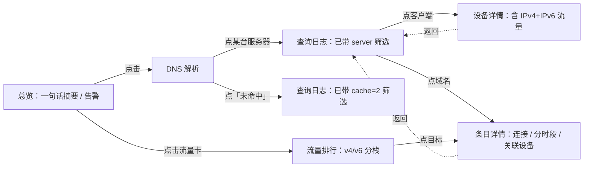

# netmon 改进项目任务书 —— IPv6 全链路 / DNS 可观测 / 使用动线优化

| 项 | 内容 |
|---|---|
| 文档版本 | v1.0（任务书，非设计定稿；实施中若有偏差需回写本文档） |
| 基线 | `main@73feba5`，`netmon 1.0.6` |
| 目标版本 | `1.1.0` |
| 编写日期 | 2026-11-14 |
| 适用范围 | `src/`（C 采集 + 报表）、`www/`（单文件前端 + CGI）、`package/`（UCI/LuCI/打包）、`build/`（测试与脱敏）、`docs/`（文档） |
| 前置条件 | 已通读仓库全部源码与文档；本任务书落盘后方可开始编码 |

> **实施后回写（2026-11-14，1.1.0 定稿前）**
>
> 本文档 §5.2.3 的「缓存命中判定」与需求 B 中 `cache_state` / `cache_ev`
> 两个字段**已整体废弃**，代码里不存在。
>
> 原因：被动旁路只能看到 LAN 侧问答，上游解析器（本机场景下是 dnsmasq，
> 被 homeproxy 接管时连明文转发都看不到）的缓存表读不到。实测判定覆盖率
> 不到 2%，绝大多数行为「未知」，照原设计展示命中率会出现「未知 98%、
> 命中率 100%」这种自相矛盾的结论。与其给一个猜出来的数字，不如不给。
>
> 保留下来的是需求 B 的另一半：**这条查询发给了哪个 DNS 服务器、应答是什么**
> —— 这部分全部取自报文本身，不需要推断。相关落地见 §5.2 其余各节与
> `RELEASE_NOTES.md`；为什么不做命中率见 `docs/DNS_REVERSE.md`。
>
> 以下正文保留原始需求与设计记录，作为「当时为什么这么想」的存档，不再代表
> 当前实现。

---

## 1. 项目现状（只读结论，作为后续设计的基线）

### 1.1 架构与数据链路

```
/proc/net/nf_conntrack ──(5s 采样)──> ctsample(开放寻址 diff) ──> 连接消亡回调
        │                                                          │
        │                                          dnsmap(IP→域名) ──┤
        │                                                          ▼
AF_PACKET(br-lan, BPF 只放行 udp/53) ──> dnssniff(查询/应答配对) ──> db.c ──> SQLite
                                                                          │
uhttpd ──> /cgi-bin/data(?since=&view=) ──> netmon-report dashboard/client/detail ──┘
                                     │
                                     └──> /www/netmon/index.html（单文件原生 JS，6 套皮肤）
```

* 采集进程 `netmon`：`src/netmon.c`（940 行），常驻，procd 托管。
* 报表进程 `netmon-report`：`src/netmon-report.c`（2710 行），**按需 fork**、只读打开库、一次输出完整 JSON。
* 前端：`www/index.html`（2510 行）单文件，7 个导航视图 + 2 个下钻视图，10 秒轮询。
* 数据文件：`/opt/netmon/data/netmon.db`；CGI 有 10 秒窗口文件缓存。

### 1.2 现有表结构（关键字段）

| 表 | 字段 | 说明 |
|---|---|---|
| `conns` | `fam(4/6) proto sport dport src dst sip cidr host zone mark pkt_o byt_o pkt_r byt_r unreplied first/last/dur_ms` | 一行 = 一条连接的一生，30 天滚动删除 |
| `dnsq` | `ts_ms qname qtype rcode ms answers upstream client_ip` | 一行 = 一条 **DNS 应答** |
| `agg_hour` / `agg_day` | `hour_ms cidr proto dport conns bytes_o/r …` | 永久聚合 |
| `probe` / `reach` / `hp_event` / `meta` | — | 历史遗留，报表仍引用 |
| 索引 | `idx_conns_t / idx_conns_cidr / idx_conns_ts(first_ms,src)`；`idx_dnsq_t / _tc / _tq / _tr` | dashboard 依赖复合覆盖索引 |

`db_init_schema()` 已有 `ensure_column()` 做幂等 `ALTER TABLE ADD COLUMN` 迁移（`dnsq.client_ip` 就是这样加的），**新字段一律沿用该机制**，不改 `CREATE TABLE` 的既有列定义。

### 1.3 前端视图与接口

* `dashboard` 输出：`summary / top_cidr / top_host / trend / dns / devices / dns_timeline / dns_recent / sysinfo / traffic_hosts / block_stats / heatmap / hp / daily`。
* `client` 输出：`device / summary / timeline / traffic_timeline / top_domains / qtypes / rcodes / recent / block_stats / traffic`。
* `detail` 输出（`src/detail.c`）：`host / qname / cidr` 三种下钻。
* CGI 只透传 `since / view / ip / type / key`，参数走白名单，后端全程 `sqlite3_bind`。
* 测试闸门：`make test`（C 断言）、`node build/render-test.js`（~126 项 DOM 桩断言，数据取自 `www/demo.html`）、`check-web.py`（DOM id / JS 语法）、`check-leak.py`（真实内网地址/主机名/运营商 IPv6 前缀）、`make-demo.py --check`（脱敏残留）。**任何改动都必须让这 5 条继续通过。**

### 1.4 不可逾越的红线（来自 `docs/DNS_REVERSE.md` / `docs/OPERATIONS.md`）

1. **只旁路、只读**：不许改 dnsmasq 配置、不许重启 dnsmasq、不许加 nftables/iptables/eBPF 规则、不许挂 XDP/TC、不许发探测包、不许改 `/etc/resolv.conf`。
2. 监控进程崩溃 / 被 kill 不得影响任何设备的解析与上网。
3. 面板无鉴权，`listen_addr` 不得默认绑 `0.0.0.0`；仓库不得出现真实内网地址、真实设备名、真实运营商 IPv6 前缀。
4. 路由器资源受限：常驻内存、数据库增速、CGI 冷查询耗时不得明显劣化（现状：采集 0.08% 单核 / 83.6 MB RSS / CGI 缓存命中 28ms / 冷查询约 4s）。
5. 前端零外部依赖、单文件、无 CDN、离线可打开；演示页与截图必须脱敏。

---

## 2. 现状问题清单（逐条定位，作为需求依据）

### 2.1 IPv6 链路的断点

| # | 位置 | 问题 |
|---|---|---|
| P1 | `src/netmon.c:369-370` `ignore_conn()` | `family==6` 只判「源是本机地址」，**不判** `::1`、`::`、`fe80::/10`、`ff00::/8`、同前缀 LAN 内互访。IPv6 组播/邻居发现会被计成上网流量。 |
| P2 | `src/netmon.c:264-266, 313-321` | 启动时只把 IPv6 地址收进 `g_self_v6`，**没有收集 IPv6 网段前缀**，`load_local_nets()` 只对 v4 打印网段，无法做 v6 同网段判定。 |
| P3 | `src/dnssniff.h:48` / `dnssniff.c:530,599,655` | `dns_event_t.client_ip` 是 `uint32_t`，**IPv6 查询的客户端身份整个丢失**（v6 分支只做配对，不回填 client）。`netmon.c:584-593` 因此写 `client_ip=NULL`。 |
| P4 | `src/dnssniff.c:466-494` `parse_dns()` | 应答里**只取第一条 A 或 AAAA 就 break**。双栈应答先给 A 再给 AAAA 时，AAAA 结果不进 `dnsmap`，于是 IPv6 目的 IP 永远反查不到域名 → IPv6 流量榜只剩裸地址。 |
| P5 | `src/netmon-report.c:2327-2346` | 设备流量归属 `GROUP BY src` 后只累加到「已存在的设备行」（`canon_ip()` 命中 v4 目录）。IPv6 源地址不在目录里 → **整条 IPv6 流量被静默丢弃**。注释亦自认「只按 IPv4 源地址归属」。 |
| P6 | `src/netmon-report.c:1317-1318` | `cmd_client` 的连接/流量统计明确写着「IPv6 源地址与 IPv4 设备 IP 不同，这里只统计 IPv4 部分」。 |
| P7 | `www/index.html:732` | 设备详情「流量目的地」面板标题写死「仅统计 IPv4 发起的连接」。 |
| P8 | `src/db.c:470-477` | `conns.sip` 只对 v4 计算数值，v6 恒为 0；`cidr` 混排 v4 `/24` 与 v6 `/48`，`top_cidr` 榜无协议栈标识，用户分不清。 |
| P9 | `src/netmon-report.c:1890-1901` | `sysinfo` 的 conntrack 摘要只数总数/TCP/UDP/ESTABLISHED，**无 v4/v6 拆分**。 |
| P10 | `src/detail.c:117` | 下钻条件 `(host=? OR dst=? OR cidr=?)` 不含 `fam`，IPv6 条目与 v4 混在一起且无标识。 |
| P11 | `README.md:383` | 「只处理 IPv4/IPv6 单播」与实际能力不符；`docs/DNS_REVERSE.md:287`「IPv6 查询不做耗时配对」已过时（代码已配对）。文档需回写。 |

> 结论：**采集层（`ctparse` / `ctsample` / `dnsmap`）其实已具备 IPv6 能力**，缺口集中在「DNS 事件客户端身份、AAAA 反查、噪音过滤、设备归属、报表口径、前端标注」这 6 处。改造重点在归属与展示，而不是重写解析器。

### 2.2 DNS 记录的信息缺口

| # | 位置 | 问题 |
|---|---|---|
| P12 | `src/db.c:245-255` / `db.h:108-124` | `dnsq` 无「查询发给哪个 DNS 服务器」字段；`upstream` 列**被误用**——`db_add_dnsq()` 把 `first_ip`（首个应答 IP）绑到了第 7 列 `upstream`。列名义为「上游 DNS」，实际存的是「解析结果」。 |
| P13 | `src/db.c:709` | `q->answers`（int 计数 0/1）被绑进 `answers TEXT` 列；而前端 `www/index.html:2401,2373` 把 `answers` 当「应答 IP」显示，`www/demo.html` 的真实样例就是 `"answers":"0"` —— **应答 IP 列显示的是 0/1，不是 IP**。 |
| P14 | 全链路 | 完全没有「是否命中缓存」的字段。schema 注释写了「是否命中缓存」，但没有任何实现。 |
| P15 | `src/dnssniff.c:436-497` | 未解析应答 TTL、DNS flags（AA/RA/TC）、事务 ID 未向上暴露；无法做缓存推断的证据采集。 |
| P16 | `src/netmon.c:90` / `src/config-netmon` / `src/init.d-netmon` | 嗅探网卡硬编码 `br-lan`，**只能通过命令行 `--sniff-if any` 改**，UCI/LuCI 里没有开关。看不到 WAN 侧转发查询，就无法用「是否向上游发起过查询」来佐证缓存判定。 |
| P17 | `src/netmon-report.c:2424-2452` | `dns_recent` 只返回 `ts/qname/qtype/rcode/ms/answers/client_ip`；前端查询日志表列固定为 时间/客户端/域名/类型/状态/耗时/应答，无处安放服务器与缓存。 |

### 2.3 使用动线的摩擦点

| # | 位置 | 问题 |
|---|---|---|
| P18 | `www/index.html:1265-1273` | 7 个导航项里没有「DNS 解析」这一视角。用户想回答「是不是 DNS 服务器慢/是不是没走缓存」，要在总览 KPI → 查询日志 → 系统信息之间来回跳，没有承接页。 |
| P19 | `www/index.html:1702-1745` | 站内告警是纯文字（「去查询日志按应答码筛选」），点了不会跳转、不会带筛选条件。 |
| P20 | `www/index.html:1224-1254` `exportCurrent()` | 「查询日志」导出的是 `d.dns_recent` **全量**，不是用户当前筛选/搜索后的 `list`；且缺新列。 |
| P21 | `www/index.html:1489-1492` `resetTimer()` | 每 10 秒无条件同时刷新 `dashboard + client/detail` 三个接口；在设备详情页也重复拉全量 dashboard（一次约 3 秒冷查询），浪费 CGI fork 且可能在用户翻页/输入时重绘。 |
| P22 | `www/index.html:1358,1424` | `crumb-back` 固定回 `#/clients`；从查询日志/域名下钻进设备详情后返回路径丢失（`detail` 视图已有 `detailFrom`，`client` 没有）。 |
| P23 | `www/index.html:1146-1155` `globalSearch()` | 输入 IPv6 地址会被判成 IP，直接跳到 `host` 下钻（多数情况无数据）；输入 DNS 服务器 IP 没有任何可搜之处。 |
| P24 | `www/index.html:1369-1393` | 切换时间范围只重置 3 个分页键，`client/detail` 的分页与筛选状态不同步；筛选条件不持久化，10 秒自动刷新后 `renderView()` 虽重绘但 hash 不带状态，刷新浏览器即丢失。 |
| P25 | `www/index.html:1471-1474` | 空库时只有「正在读取监控数据…」骨架，成功返回空数据后各面板散落「暂无数据」，没有「新装后该做什么」的引导。 |

---

## 3. 需求拆解与验收标准

### 需求 A：增强 IPv6 能力（流量分析不再只支持 IPv4）

| 子项 | 内容 | 验收标准 |
|---|---|---|
| A1 | DNS 事件携带完整 16 字节客户端/服务端地址 + 协议族 | IPv6 客户端的查询能出现在「客户端」列表、设备详情与查询日志，带 `IPv6` 标识 |
| A2 | 应答中的 A 与 AAAA **全部**入 `dnsmap` | 双栈域名解析后，IPv6 目的 IP 在流量榜显示域名而非裸地址 |
| A3 | IPv6 噪音过滤对齐 v4（回环/未指定/链路本地/组播/同前缀内互访/本机地址） | 构造帧单测覆盖；ND/组播不产生 `conns` 行 |
| A4 | 连接记录补齐「LAN 侧地址 + 方向」 | 无 NAT 的 IPv6 **入站**连接也能归属到设备，且上下行不颠倒 |
| A5 | 报表所有设备归属改用 LAN 侧地址 | IPv6 流量进入设备 KPI、设备榜、设备详情流量趋势与目的地榜 |
| A6 | v4/v6 分栈统计与标识 | 总览/流量排行/系统信息能看到 v4、v6 的连接数、字节数、查询数与占比；`cidr` 榜标注协议族 |
| A7 | 文档回写 | README「限制」、`docs/DNS_REVERSE.md` 遗留限制、`docs/WEB.md` 与本文同步 |

**不可接受**：把 IPv6 连接折算成 IPv4、把 v6 地址当 v4 解析、v6 流量重复计量、为支持 v6 而破坏 v4 现有统计口径。

### 需求 B：DNS 记录直接看到「哪个 DNS 服务器」与「是否命中缓存」

| 子项 | 内容 | 验收标准 |
|---|---|---|
| B1 | 每条 DNS 应答记录 `server_ip / server_fam / server_port` | 查询日志每行显式显示「查询发往 192.168.1.1（本机 dnsmasq）」或「223.5.5.5（阿里公共 DNS）」 |
| B2 | 服务器友好名 + 服务器维度聚合 | 新增「DNS 解析」视图：各服务器查询量、占比、平均耗时、命中率、上游分布；点击服务器直接筛查询日志 |
| B3 | 缓存状态 `cache_state` + 判定依据 `cache_ev` | 每行显示「命中缓存 / 未命中（已转发）/ 本地记录 / 未知」，悬停说明依据；筛选器可按状态过滤 |
| B4 | 记录 TTL、应答 IP 列表、应答条数 | 「应答 IP」列显示真实 IP（修复 P13），CSV 导出含全部新列 |
| B5 | 上游服务器 `upstream_ip`（观测到时） | 未命中时能显示「本机 dnsmasq → 223.5.5.5」，并说明这是**观测推断** |
| B6 | 诚实标注推断边界 | 页面固定说明：被动旁路无法读取 dnsmasq 内部缓存表，结论来自「LAN 侧应答时延 + 是否观测到上游转发 + TTL 衰减」；无法判定时显示「未知」，**不猜** |

**验收口径（必须写进 UI 与文档）**：
「命中缓存」是**推断值**，不是 dnsmasq 自报的事实。判定优先级见 §5.2.3；三条证据都不足时输出 `unknown`。DoH/DoT/上游加密 DNS 场景必须能降级为「未知」而不是误判为命中。

### 需求 C：结合使用动线做系统优化

| 子项 | 内容 | 验收标准 |
|---|---|---|
| C1 | 新增「DNS 解析」一等视角，串起「总览异常 → 服务器/缓存 → 具体查询 → 设备」 | 4 步内可达，每步有可点入口；总览摘要与告警带直达链接 |
| C2 | 告警一键定位 | 每条告警点击后跳到对应视图并自动应用筛选（应答码 / 时间 / 设备 / 服务器） |
| C3 | 查询日志筛选与导出一致 | 导出的是当前筛选结果，列与页面一致；新增「服务器」「缓存」筛选 |
| C4 | 刷新策略按视图收敛 | 设备详情只刷 `client`、条目详情只刷 `detail`、其余只刷 `dashboard`；用户正在输入框内输入时跳过本轮刷新 |
| C5 | 返回路径与状态保持 | 设备详情返回来源视图；筛选/分页/协议栈选择写入 URL hash，刷新浏览器不丢 |
| C6 | 空状态引导 | 空库时给出「确认服务在跑 → 确认流量经过本机 → 看系统信息」三步行与直达按钮 |
| C7 | 移动端与皮肤 | 新增列在 390px 下由 `labelizeRows()` 自动带标签，6 套皮肤对比度不变 |

---

## 4. 总体设计原则

1. **单源 + 向后兼容**：所有新列走 `ensure_column()`；所有新 JSON 字段**只增不改**旧字段语义（`answers` 的语义修复需同时兼容旧行 `"0"/"1"`）；旧库不迁移数据也能打开，新字段为 NULL/默认值。
2. **不改写历史数据**：`conns` 新增 `client_ip` 不做 `UPDATE` 回填（百万行代价高），报表统一用 `COALESCE(client_ip, src)`。
3. **旁路只读不变**：为判定缓存而「多看一眼 WAN 侧转发查询」仍只是 AF_PACKET 多收一个接口的帧，不新增任何钩子、不发包。
4. **性能守恒**：`dnsq` 新增列带来每字节写入增量需评估；只加 2 个复合索引；缓存判定用固定大小环形表 + 哈希，O(1)、无 malloc、有上限。
5. **诚实优先**：任何无法从被动观测确证的信息，UI 上标「推断」或「未知」并给出依据，不编造确定性结论。
6. **一个请求拿全部数据**的 CGI 约定不变，不新增 HTTP 接口；新维度继续放进 `dashboard` 单次 JSON。
7. **零前端依赖**：不引入框架、图表库、CDN；沿用原生 JS + CSS 变量 + `labelizeRows()`。

---

## 5. 详细设计

### 5.1 IPv6 全链路

#### 5.1.1 数据结构统一：`src/ctparse.h` 的 `ct_key_t` 已含 `family` 与 16 字节地址

`ctparse.c` 已能解析 `ipv6` 行、`icmpv6`、`db_ip_str()` 已支持 v6、`dnsmap` 已用 `norm_key()` 统一 v4-mapped / 原生 v6。**不改这些**，只补单测（`src/test_ctparse.c` 增加 IPv6 conntrack 行样例）。

#### 5.1.2 `src/dnssniff.h/.c`：事件结构升级

```c
#define DNS_MAX_ANS 8
typedef struct {
    uint8_t  family;        /* 4 或 6 */
    uint8_t  ip[16];        /* v4 统一存 v6-mapped，与 dnsmap 一致 */
    uint32_t ttl;
} dns_answer_t;

typedef struct {
    char     qname[128];
    uint16_t txid;
    int      qtype, rcode;
    uint16_t flags;         /* DNS header flags，供 AA/RA/TC 判定 */
    double   ms;            /* -1 = 未配对 */
    uint8_t  is_query;
    uint8_t  client_fam, server_fam;
    uint8_t  client[16], server[16];   /* 全地址，v4 用 v6-mapped */
    uint16_t server_port;
    uint32_t client_ip;     /* 兼容旧字段：仅 v4 有效，勿在新代码里用 */
    uint8_t  n_ans;
    dns_answer_t ans[DNS_MAX_ANS];
    uint16_t an_count;      /* 应答区记录总数（含 CNAME 等） */
} dns_event_t;
```

* 查询帧：`client = ip.src`、`server = ip.dst`、`server_port = dport`。
* 应答帧：`client = ip.dst`、`server = ip.src`、`server_port = sport`。
* v4 / v6 两条分支都按上述规则填充，v6 不再丢失客户端身份。
* `parse_dns()` 改为遍历全部 answer 记录：收集 A/AAAA（最多 8 条）、各自 TTL、`an_count`；CNAME 等跳过但不中断；压缩指针解析保持原逻辑。
* `pend_*` 配对键不变（txid + 客户端地址哈希 + 端口 + qtype），v6 分支继续用 `mix64_addr()`。
* BPF 过滤器保持现状（IPv4 分支含分片检查、IPv6 分支固定 40 字节头）；**新增**对 IPv6 VLAN 帧与扩展头的说明性注释，暂不扩展 BPF（DNS 不走扩展头，扩展会带来误判风险）。

#### 5.1.3 `src/netmon.c`：噪音过滤与方向归一

* `load_local_nets()` 增加 `g_lnet6[MAX_LOCAL_NET]`：`{uint8_t net[16]; uint8_t pfx;}`，从 `getifaddrs()` 的 `AF_INET6` 项取地址与 `ifa_netmask` 前缀长度；跳过 `::1`、link-local、`/128`、ULA 之外的无效项；日志按 `2001:db8::/64` 形式打印。
* `ignore_conn()` 的 v6 分支补齐：
  1. `::` / `::1`；
  2. `fe80::/10` link-local；
  3. `ff00::/8` 组播；
  4. 源与目的落在同一个本机 IPv6 前缀（LAN 内互访不计）；
  5. 源是本机任一 IPv6 地址（tun 代理重复计量）。
* **方向归一**：新增 `lan_side()` 判定——若 `src` 命中本机 IPv4/IPv6 前缀（LAN 侧）则 `dir=0`（出向），若 `dst` 命中而 `src` 不命中则 `dir=1`（入向）。落库时 `client_ip` 存 LAN 侧地址文本（始终是被统计的那台设备），`dir` 存方向；报表按 `dir` 决定 `byt_o/byt_r` 谁是上行。
  * v4 现有数据 `dir` 默认 0、`client_ip` 为 NULL → `COALESCE(client_ip, src)` 退回旧口径，统计不变。
* `on_dns_event()`：遍历 `e->ans[]` 全部调用 `dnsmap_add()`；`client_ip` 用 `inet_ntop()` 按 `client_fam` 格式化（v4 取 v6-mapped 后 4 字节），写 `client_fam`。

#### 5.1.4 `src/db.c/.h`：连接表新增列

| 新列 | 类型 | 默认 | 用途 |
|---|---|---|---|
| `client_ip` | TEXT | NULL | LAN 侧地址（设备归属），NULL = 旧行，用 `src` 兜底 |
| `dir` | INTEGER | 0 | 0=LAN→WAN，1=WAN→LAN |
| `dst_pfx` | TEXT | '' | 规范化目的前缀（v4 `a.b.c.0/24` / v6 `…::/48`），与 `cidr` 并存以便带族标识展示 |

`db_add_conn()` 签名扩展为接收 `client_ip` 与 `dir`；`sip` 对 v6 仍写 0，同时新增 `sip6_hi/sip6_lo`（两个 64 位整数，取目的地址高/低 8 字节）供 v6 范围排序（可选，若实现则一并加索引评估）。`make_cidr()` 输出统一带族前缀：`v4: 192.0.2.0/24` / `v6: 2001:db8:1::/48`，报表用 `cidr LIKE '%:%'` 或 `fam` 字段判族。

#### 5.1.5 `src/netmon-report.c`：口径改造

* 所有设备归属 SQL 由 `src` 改为 `COALESCE(client_ip, src)`：`cmd_client` 的 `summary / traffic_timeline / traffic`、`cmd_dashboard` 的设备流量累加、`src/detail.c` 的连接明细与设备榜。
* `cmd_client()` 的 `_self_ips` 临时表同时容纳该设备的 v4 与 v6 地址：从 `devrec_t.aliases` 之外，再查 `g_n6[]`（`ip -6 neigh` 中同 MAC 的地址）补全；`valid_ip()` 已支持 v6，CGI 已处理 `%3A`，无需改白名单。
* `load_catalog()` 增加「从 `ip -6 neigh` 按 MAC 反查，把 IPv6 地址登记为同一台设备的别名」：`dev_add(v6, name, mac, DEV_MAC)` 并让 `build_aliases()` 按 MAC 归并到 v4 规范地址。这样 IPv6 地址既能成为设备身份，又不会多出一台「未命名设备（IPv6）」。
* `summary` 新增 `stack` 子对象：`{v4:{conns,queries,bytes_out,bytes_in,clients}, v6:{…}}`；`sysinfo` 新增 `ct_v4/ct_v6`；`top_cidr / traffic_hosts / trend / devices` 每行带 `fam`。
* `cmd_top/trend/dns/devices` 增加 `--fam 4|6|all`（默认 all），文本输出增加协议族列。
* 前端删除「仅统计 IPv4 发起的连接」文案，改为「含 IPv4 / IPv6，按 LAN 侧地址归属」。

### 5.2 DNS 服务器与缓存可观测

#### 5.2.1 数据模型（`dnsq` 新增列，`ensure_column` 幂等迁移）

| 新列 | 类型 | 默认 | 说明 |
|---|---|---|---|
| `server_ip` | TEXT | NULL | 客户端把查询发给谁（v4/v6 文本） |
| `server_fam` | INTEGER | 4 | 4 / 6 |
| `server_port` | INTEGER | 53 | 服务端端口（识别非标端口/代理 DNS） |
| `upstream_ip` | TEXT | NULL | 观测到本机解析器转发时的上游 DNS |
| `client_fam` | INTEGER | 4 | 客户端地址协议族 |
| `cache_state` | INTEGER | 0 | 0=未知 1=命中缓存 2=未命中/已转发 3=本地记录 |
| `cache_ev` | INTEGER | 0 | 位掩码证据：1=低时延 2=观测到上游转发 4=TTL 衰减 8=本地记录特征 |
| `ttl` | INTEGER | NULL | 首个 A/AAAA 应答 TTL（秒） |
| `answer_cnt` | INTEGER | 0 | A/AAAA 应答条数 |
| `answer_ips` | TEXT | NULL | 逗号分隔的应答 IP（v4/v6 混合） |

**历史列处置**：
* `answers`：新行写入 `answer_ips` 的内容（逗号分隔 IP），修复 P13；旧行 `"0"/"1"` 由报表读时归一成空串，前端显示「—（旧记录）」。
* `upstream`：新行写入真实的 `upstream_ip`（无则 NULL），不再写首个应答 IP；旧行保留原值，报表以 `upstream_ip` 新列为准，避免歧义。
* 新增索引：`idx_dnsq_server(ts_ms, server_ip)`、`idx_dnsq_cache(ts_ms, cache_state)`；不新建单列索引，避免写放大。

#### 5.2.2 DNS 服务器命名（`src/netmon-report.c` 新增 `dns_label()`）

判定顺序（输出 `server_label`）：
1. `server_ip` 命中本机接口地址（`getifaddrs()` 现取，含 v4/v6）→ `本机 dnsmasq`；
2. 内置公共解析器表（IPv4 + IPv6）：`223.5.5.5 / 223.6.6.6 / 2400:3200::1 → 阿里`；`119.29.29.29 / 2402:4e00:: → 腾讯`；`114.114.114.114 → 114DNS`；`1.1.1.1 / 2606:4700:4700::1111 → Cloudflare`；`8.8.8.8 / 2001:4860:4860::8888 → Google`；`9.9.9.9 → Quad9`；`180.76.76.76 → 百度`；
3. 私有 / ULA / link-local 地址 → `局域网 DNS`；
4. 其余 → 原样显示 IP，并标 `自定义/上游`。

> 该表是**纯展示映射**，不参与任何采集/转发决策；允许通过 `/etc/config/netmon` 的 `dns_labels` 列表覆盖（可选，优先级最低，若时间不足放到二期）。

#### 5.2.3 缓存命中判定（核心，必须诚实）

被动旁路**无法读取 dnsmasq 内部缓存表**，因此采用多证据推断，输出 `cache_state + cache_ev`：

| 优先级 | 证据 | 结论 | `cache_ev` 位 |
|---|---|---|---|
| 1 | 在 LAN 侧应答到达前 `W=3s` 窗口内，观测到**本机解析器向外部 DNS 发出同名同类型查询** | `2 未命中（已转发）` | `2`，并写 `upstream_ip` |
| 2 | 应答来自本机/局域网解析器，且 TTL 相比该 `(qname,qtype,server)` 最近一次基线**下降**（`ttl < last_ttl`） | `1 命中缓存` | `4 \| 1`（若同时低时延） |
| 3 | 应答耗时 `ms <= cache_ms`（默认 2.0 ms，可配）且应答来自本机/局域网解析器 | `1 命中缓存（低时延推断）` | `1` |
| 4 | 明显是本地记录（`.lan` / `localhost` / 反向 PTR / TTL=0 / AA 位置位且来自本机） | `3 本地记录` | `8` |
| 5 | 以上都不满足（含上游走 DoH/DoT、抓不到转发帧、未配对到查询） | `0 未知` | `0` |

实现约束：
* 「上游转发观测」依赖能看到 WAN 侧帧 → 新增 UCI `dns_sniff_if`（默认 `br-lan`，可选 `any`）；当值为 `any` 时一个 AF_PACKET  socket 收全部网卡。判定表在 `netmon.c` 内用固定容量环形数组（4096 槽，键 = FNV(qname+qtype+server)，存 `ts_ms / upstream_ip`），**无动态内存、有 TTL 清理**。
* `cache_ms` 可配：命令行 `--cache-ms`，UCI `option dns_cache_ms '2'`，LuCI 加一个数值项；`init.d-netmon` 传参。
* TTL 基线表：固定 2048 槽开放寻址，键 `(qname,qtype,server)`，存 `last_ttl / ts`，超时 1 小时自动失效。
* **降级路径**：只监听 `br-lan` 时证据 1 不可用，判定退到 2/3/4；所有证据缺失时前端显示「未知」并提示「把嗅探接口改成 any 可提高判定率」。
* 判定只发生在 `on_dns_event()` 的应答分支，纯内存计算，不增加数据库查询。

#### 5.2.4 报表接口新增字段（全部为新增，旧字段不动）

`dashboard` 新增：

```
dns_servers: [{ip,label,fam,port,n,hit,miss,local,unknown,hit_rate,avg_ms,upstreams:[{ip,n}]}]
cache:       {hit,miss,local,unknown,total,hit_rate,ev:{rtt,upstream,ttl,local},reliable:0|1}
stack:       {v4:{...}, v6:{...}}          # 见 §5.1.5
summary:     + v6_bytes_out/v6_bytes_in/v6_conns/v6_queries/dns_servers_n
dns_recent:  每行 + server,server_label,server_fam,cache,cache_ev,ttl,upstream,answer_cnt,client_fam
devices:     每行 + fam, v6_conns, v6_bytes_out, v6_bytes_in
top_cidr / traffic_hosts / top_host / trend: 每行 + fam
sysinfo:     + ct_v4, ct_v6
```

`client.recent` / `client.traffic` / `detail` 的 DNS 明细同步补 `server / cache / ttl / answers` 字段。

新增 CLI：`netmon-report servers [--since 24h] [-j]`（服务器维度文本/JSON），`netmon-report dns --server IP --cache 0|1|2|3 --fam 4|6` 过滤；`dashboard --fam 4|6|all`。

CGI：`www/cgi-bin-data` 透传 `fam` 参数（纯数字白名单 `4|6|0`），缓存文件名加入 `fam`，避免不同协议栈视图串数据。

#### 5.2.5 前端「DNS 解析」视图（需求 B 与 C1 的汇合点）

新增第 8 个导航项 `dns`（图标 `globe`），页面包含：

1. **KPI 四张**：DNS 服务器数、缓存命中率、平均应答耗时、判定覆盖率（非「未知」占比）。
2. **服务器榜**：名称 / IP（带 IPv4·IPv6 徽标）/ 查询量占比条 / 命中率 / 平均耗时 / 主要上游；点击行 → 查询日志并自动带 `server` 筛选。
3. **缓存构成**：命中 / 未命中（转发）/ 本地记录 / 未知 四类环形图 + 证据来源分布（`rtt / upstream / ttl / local`），下方固定说明判定方法与「推断」边界。
4. **按服务器 × 时段的耗时对比**：沿用现有 `barChart()`，不引入图表库。
5. **最近查询**（复用查询日志组件，带服务器与缓存列）。

查询日志表列调整为：`时间 | 客户端 | 域名 | 类型 | 状态 | DNS 服务器 | 缓存 | 耗时 | 应答 IP`（窄屏由 `labelizeRows()` 自动带标签，CSS `g-log2` 扩为 9 列并加 390px 断点隐藏次要列）。

### 5.3 使用动线优化

#### 5.3.1 目标动线



#### 5.3.2 具体改造

* **C1**：见 §5.2.5。
* **C2**：`computeAlerts()` 的每条告警增加 `go:{view, rcode?, cls?, server?, ip?}`；`renderAlerts()` 渲染成可点元素，点击后写 `S` 状态并 `location.hash` 跳转。现有文案「去查询日志按应答码筛选」变成真正可执行的动作。
* **C3**：`exportCurrent()` 改为接收「当前视图筛选后的数组」；抽出 `filteredQueries(d)` 供渲染与导出共用；CSV 列与表头一致（含服务器 / 缓存 / TTL / 应答 IP）。
* **C4**：`resetTimer()` 按 `S.view` 决定刷新目标；`document.activeElement` 是输入框时跳过本轮（不打断用户输入）；`client/detail` 视图保留上一次 `S.data` 作为 `now_ms` 与设备目录来源。
* **C5**：`navigate()` 记录 `S.clientFrom`；`crumb-back` 与 Esc 回该来源。筛选/分页/协议栈选择序列化进 hash（如 `#/queries?rcode=3&cache=1&p=2`），`navigate()` 解析回填；自动刷新不覆盖用户当前分页。
* **C6**：`renderView()` 在 `summary.queries===0 && summary.win_conns===0` 时，总览顶部渲染三步引导卡（服务状态 → 部署拓扑 → 系统信息来源），按钮直达 `#/system`；不新增接口。
* **C7**：新增 CSS 类沿用 `var(--*)`；`g-log2` 扩列后补 `@media(max-width:900px)` 与 390px 规则；`check-web.py` 的 id 校验、`render-test.js` 的断言同步扩充。

---

## 6. 配置变更

| 文件 | 变更 |
|---|---|
| `src/config-netmon` | 新增 `option dns_sniff_if 'br-lan'`、`option dns_cache_ms '2'`（含注释说明 any 的收益与抓包量代价） |
| `src/init.d/netmon` | `config_get` 两项，传 `--sniff-if` 与 `--cache-ms`；值为 `any` 时映射为不 bind |
| `src/netmon.c` | `parse_args()` 增加 `--sniff-if` 解析（已有）、`--cache-ms`；`cfg_t` 增加 `double cache_ms` |
| `package/luci-app-netmon/.../settings.lua` | 增加「DNS 嗅探接口」下拉（br-lan / any）、「缓存判定时延阈值」输入；描述里写清「any 会看到更多帧，判定更准，但不影响转发」 |
| `src/netmon-apply` | 日志追加新参数值；其余逻辑不变（仍只重启自己的服务） |
| `www/cgi-bin-data` | 透传 `fam`，缓存 key 加 `fam` |

---

## 7. 兼容、性能与隐私

* **旧库**：`ensure_column()` 幂等加列；旧 `dnsq` 行新字段全 NULL，前端按「未知」显示；旧 `conns` 行 `client_ip IS NULL`，报表 `COALESCE(client_ip, src)` 保持原值。**不写任何回填 UPDATE**。
* **旧前端 / 新旧混跑**：JSON 只增字段；`answers` 旧值 `"0"/"1"` 归一为空串；`upstream` 旧值不再被当作服务器使用。
* **性能**：
  * `dnsq` 每行增加约 60~100 字节；按现状 43 万条/天估算约 +30 MB/月，在 1.4 GB/月基数上可接受；若实测超 10% 则把 `answer_ips` 限制为前 4 个地址、`qname` 保持原长。
  * 缓存判定两张固定表 ≤ 4096 + 2048 槽，常驻内存 < 200 KB；每应答 O(1) 哈希，无 malloc、无 SQL。
  * `dns_servers` / `cache` / `stack` 由 `dashboard` 内复用已有 `dnsq` 时间窗扫描聚合，**不新增全表扫描**（在现有 `SELECT ... WHERE ts_ms>=?` 上用 `SUM(CASE WHEN …)` 追加列，或最多增加 2 条覆盖索引查询）。
  * CGI 10 秒窗口缓存保持不变；`fam` 进入缓存 key。
* **隐私**：新增字段会记录 DNS 服务器 IP（通常为本机或公共解析器）。`build/make-demo.py` 的 `PUBLIC_DNS` 白名单已存在，需扩展 IPv6 公共解析器；脱敏规则对 `server_ip` / `upstream_ip` / `answer_ips` 同样生效；`build/check-leak.py` 增加对新增字段的示例检查。文档示例统一用 `192.168.1.x` / `192.0.2.x` / `198.18.0.0/15` / `2001:db8::/32`。
* **安全**：`server_ip` 来自报文，进入 SQL 一律 `sqlite3_bind_text`；进入 HTML 一律 `esc()` / `json_esc()`；CGI 白名单不放宽。

---

## 8. 测试与验收

### 8.1 自动化（CI 五道闸门必须全绿）

| 闸门 | 新增内容 |
|---|---|
| `cd src && make && make test` | `test_ctparse`：IPv6 conntrack 行（含 icmpv6）解析；`test_dnssniff`：IPv6 查询/应答帧的客户端与服务器地址、AAAA 应答、多答案收集、TTL、flags、非 53 端口忽略；`test_db`：新列写入/读出、`ensure_column` 对旧库幂等；`test_dnsmap`：AAAA 映射与 v6 反查 |
| `node build/render-test.js` | 新增「DNS 解析」视图渲染、服务器榜、缓存徽标、告警跳转、筛选后导出、v4/v6 徽标、按视图刷新、空状态引导等断言；既有用例不得回归 |
| `python3 build/check-web.py` | 新增 DOM id / JS 语法 / SVG 变量规则 |
| `python3 build/check-leak.py` | 新增字段样例不引入真实地址 |
| `python3 build/make-demo.py --check` | `www/demo.html` 与 `docs/demo/index.html` 两份同步更新，含新字段样例值 |

### 8.2 手工验收清单（在路由器或离线预览上）

1. 双栈环境下，同一台设备同时有 A 与 AAAA 查询：设备列表只出现一台，卡片带 `IPv4 + IPv6` 标识，流量含 v6 字节。
2. 访问一个双栈域名后，流量榜里 IPv6 目的地址显示为域名。
3. 查询日志任选一行：能看到「DNS 服务器」名称/IP、「缓存」状态与悬停依据、「应答 IP」是真实地址而不是 0/1。
4. 「DNS 解析」页服务器榜可点，跳转后查询日志筛选条件生效；导出 CSV 与该筛选结果一致且列齐全。
5. 把 `dns_sniff_if` 从 `br-lan` 切到 `any`，未命中判定数与判定覆盖率上升，且 DNS/上网不受影响（对照 `logread` 与一次解析）。
6. 切到 390px 窄屏，新增列带标签不溢出；6 套皮肤下文字可读。
7. 老库（1.0.6 的 db 文件）直接用新二进制打开：不报错、历史数据显示、新字段显示「未知 / —」。
8. `top -p $(pidof netmon)` 观察 10 分钟，RSS 与 CPU 无明显增长。

### 8.3 文档交付

* `docs/README.md` 增加本任务书索引；
* `docs/WEB.md` 更新接口字段、页面功能、「后续可加的功能」（其中若干已实现，需改写）；
* `docs/DNS_REVERSE.md` 的「遗留限制」章节回写（IPv6 配对已支持、缓存判定为推断）；
* `README.md` 的「限制」「功能」「架构」章节同步；
* `docs/OPERATIONS.md` 增加「缓存判定不准时怎么查」与 `dns_sniff_if=any` 的说明；
* `RELEASE_NOTES.md` 与两个 `package/*/Makefile` 的版本号升到 `1.1.0`。

---

## 9. 实施分解（WBS）

| 阶段 | 任务 | 主要文件 | 完成判据 |
|---|---|---|---|
| S0 | **任务书落盘（本次前置）** | `docs/TASKBOOK-1.1.md` | 本文档存在并经审阅 |
| S1 | 数据模型与迁移 | `db.c/h`, `test_db.c`, `Makefile` | 旧库可开、新列可写、`make test` 通过 |
| S2 | DNS 嗅探事件升级 | `dnssniff.c/h`, `test_dnssniff.c` | v4/v6 客户端+服务器地址、多答案、TTL、flags 单测通过 |
| S3 | 采集侧 IPv6 过滤、方向、缓存判定 | `netmon.c`, `config-netmon`, `init.d-netmon` | 环形表 O(1)、无 malloc；v6 噪音帧不入库；日志可观测判定覆盖率 |
| S4 | 报表口径与新增接口 | `netmon-report.c`, `detail.c`, `cgi-bin-data` | `dashboard/client/detail/servers/dns` 输出符合 §5.2.4；`COALESCE(client_ip,src)` 全量替换 |
| S5 | 前端「DNS 解析」视图 + 查询日志列 + 动线优化 | `www/index.html`, `www/demo.html`, `docs/demo/index.html` | `render-test.js` / `check-web.py` 全绿 |
| S6 | 脱敏、文档、版本号、CI | `build/make-demo.py`, `check-leak.py`, `docs/*`, `README.md`, `package/*/Makefile` | 5 道闸门全绿；`www/demo.html` 与 `docs/demo/index.html` 一致 |
| S7 | 回归与验收 | 全仓 | §8.2 手工清单逐项确认；`git diff --check` 干净 |

**并行边界**：S1/S2 可并行；S3 依赖 S1+S2；S4 依赖 S1；S5 依赖 S4 的 JSON 契约（可先按契约写、后联调）；S6 依赖全部。

---

## 10. 风险与对策

| 风险 | 影响 | 对策 |
|---|---|---|
| 缓存判定被误当成事实 | 用户据此误判 DNS 配置 | UI 固定标注「推断」+ 依据位 + 「未知」态；文档明确被动旁路的固有限制；不写「命中率 100%」这类绝对结论 |
| `dns_sniff_if=any` 抓包量上升 | CPU / 丢帧 | 保持现有 BPF（只放行 udp/53）与 32MB 接收缓冲；默认仍 `br-lan`；`stat:` 心跳增加 `kernel_drops` 与判定覆盖率，便于观察 |
| IPv6 前缀识别错误（RA 给的 /64、PD 给的 /56） | 同网段互访误过滤或漏过滤 | 严格用 `getifaddrs()` 的 `ifa_netmask` 计算前缀，日志打印识别结果；不写死任何网段；对 `/128` 与 link-local 跳过 |
| 方向归一改变 v4 历史口径 | 老数据趋势跳变 | `dir` 默认 0、`client_ip` 为 NULL 时 `COALESCE` 退回 `src`；新旧口径在报表里一致 |
| 新增列导致 `dnsq` 写放大 / 库膨胀 | Flash 机型 | 只加 2 个复合索引；`answer_ips` 限长；`retain` 仍可调；验收第 8 条实测 |
| 「服务器名称」映射表过时 | 显示错误标签 | 映射只做展示；未命中一律显示原始 IP；允许 UCI 覆盖（二期） |
| 前端单文件膨胀 / 移动端溢出 | 体验倒退 | 复用现有组件与 CSS 变量；新增列走 `labelizeRows()`；`check-web.py` 与窄屏断点同步 |
| 演示页含真实 DNS 服务器/内网地址 | 隐私事故 | `make-demo.py` 脱敏规则覆盖新字段；`check-leak.py` + `--check` 双闸门 |

---

## 11. 术语

* **LAN 侧地址**：一条连接中属于被监控内网的那端（出向连接是 `src`，入向连接是 `dst`）；设备归属只认它。
* **DNS 服务器**：客户端把查询报文发给的那个 IP（查询的 `dst` / 应答的 `src`），通常是路由器上的 dnsmasq。
* **上游 DNS**：本机解析器为回答该查询而向外发出的查询目标；只有嗅探到 WAN 侧帧才知道。
* **命中缓存**：本项目的**推断结论**，指应答未经过上游转发，由本机解析器直接用缓存/本地记录作答。
* **判定覆盖率**：`1 - unknown / total`，衡量当前嗅探配置下缓存判定的可用程度。
